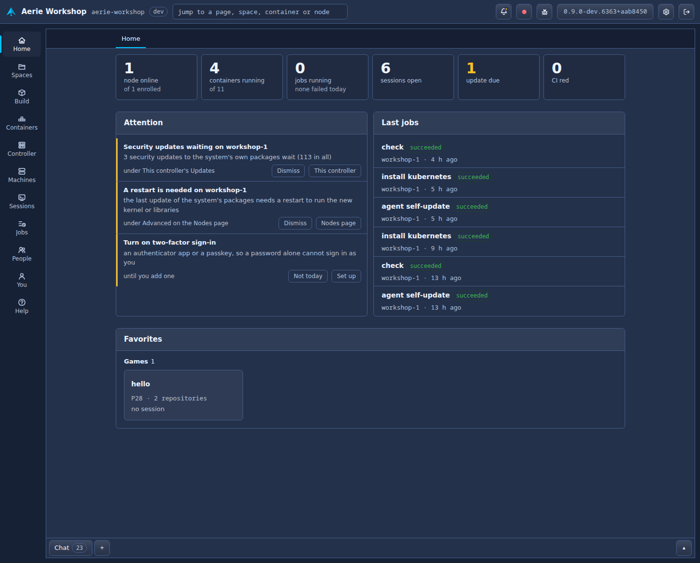
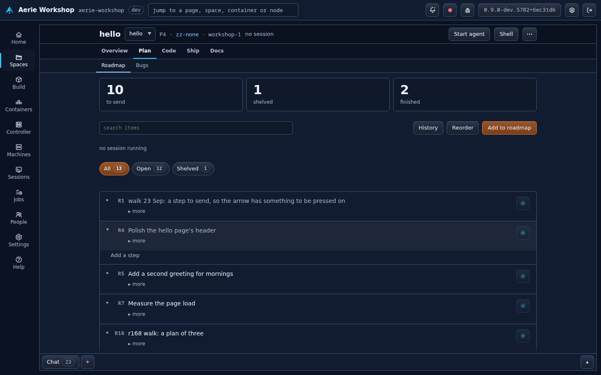
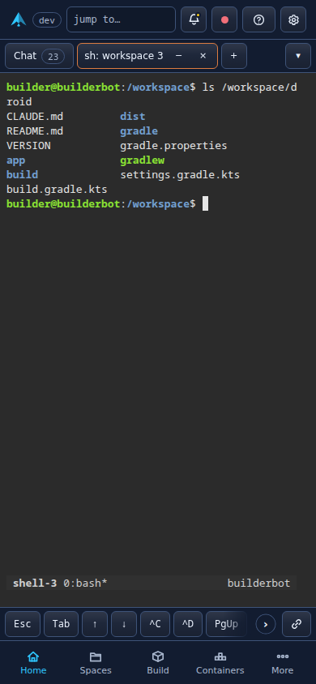

<p align="center">
  
</p>

<h1 align="center">AerieOS</h1>

<p align="center">
  <b>Your own server, with coding agents that keep working after you close the tab.</b>
</p>

<p align="center">
  <a href="https://github.com/aquilaelabs/aerieos/actions/workflows/build-image.yml"></a>
  <a href="https://github.com/aquilaelabs/aerieos/actions/workflows/dashboard.yml"></a>
  <a href="LICENSE"></a>
</p>

<p align="center">
  
</p>

Open a space from any browser, at a desk or on your phone, and Claude Code,
Codex, Copilot or Grok starts on a machine you own, already briefed with the
space's house rules, roadmap and open bugs. Close the tab and it keeps going.
Underneath is a real home server: your disks, shares, apps and VMs in the same
dashboard.

- **Agents on your hardware.** Every session runs on a machine you enrolled,
  in a real terminal you can open from anywhere, not in someone else's cloud.
- **Every project in one place.** Each space has its roadmap, bug tracker, git,
  tests, containers, VMs and wiki, shared by you and every agent that works there.
- **You decide what agents may do.** Pushing, releasing, running containers:
  each is a dial set to allowed, asked of you on your phone, or refused. Agents
  never hold your git tokens.
- **A server first.** Pools or an array with parity, shares, snapshots,
  backups, media apps and VMs. It is a complete NAS with no AI at all until
  you install an agent.

<p align="center">
  
  
</p>

## Try it

> [!WARNING]
> AerieOS is early software, and its agents edit, commit and push code. Try it
> on repositories made for testing, and check that the projects you use it on
> allow AI coding tools.

**As a container** on any host with Docker, the fastest way in:

<details>
<summary>The compose file</summary>

```yaml
services:
  aerie-workshop:
    image: ghcr.io/aquilaelabs/aerieos:dev   # no stable release yet
    container_name: Aerie-Workshop
    hostname: aerie-workshop
    restart: unless-stopped
    stdin_open: true
    tty: true
    ulimits:
      memlock: -1         # the dashboard keeps the keys it holds out of swap
      core: 0
    environment:
      PUID: 1000          # the owner of the folders below (id -u)
      PGID: 1000          # (id -g)
      TZ: Etc/UTC
      DASHBOARD_PORT: 7680
    volumes:
      - /srv/projects:/workspace          # your spaces: one folder each
      - /srv/aerieos/sdk:/sdk             # the controller's own toolchains
      - /srv/aerieos/home:/home/builder   # each account's home
      - /srv/aerieos/config:/config       # accounts, settings, notebooks, logs
      - runner-tokens:/config/runner-tokens
    ports:
      - "7680:7680"
    logging:
      driver: json-file
      options: {max-size: "20m", max-file: "3"}

volumes:
  runner-tokens:
```

</details>

```bash
mkdir -p /srv/projects /srv/aerieos/{home,config,sdk} && chown -R 1000:1000 /srv/projects /srv/aerieos
docker compose up -d     # with the compose file above saved as docker-compose.yml
```

**On a Linux machine of its own**, as the controller and its own node:

```bash
git clone https://github.com/aquilaelabs/aerieos.git && cd aerieos
sudo bash nodes/install-controller.sh --install
```

**As its own OS** from a USB stick: experimental, see [the image](docs/image.md).

Then open `http://YOUR-SERVER:7680` and make the owner account right away:
until you do, anyone who reaches the page can. The dashboard walks you through
the rest: a machine for the agents, an agent on it, and your first space.
Every option is in [the install guide](docs/install.md).

## Learn more

- [Everything it does](docs/features.md), one area at a time
- [Start here](docs/start-here.md), for someone given an account
- [How it works](docs/how-it-works.md), and [the rest of the docs](docs/README.md)
- [Data and privacy](docs/privacy.md): nothing is sent to us

[Apache License 2.0](LICENSE). Copyright 2026 aquilaeLabs; see [NOTICE](NOTICE).
